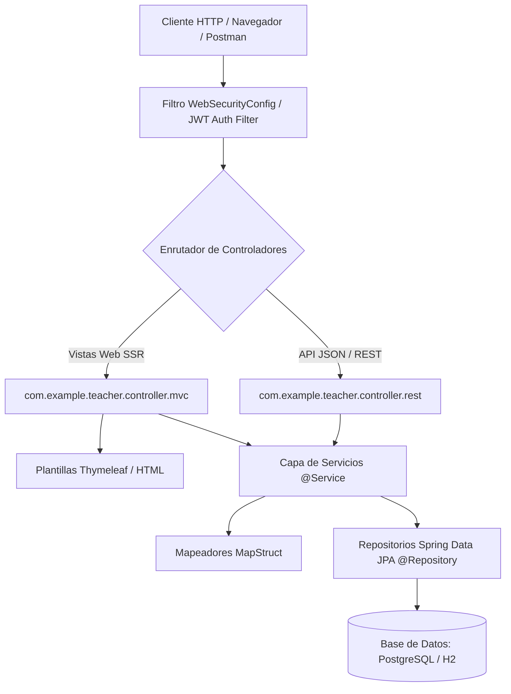
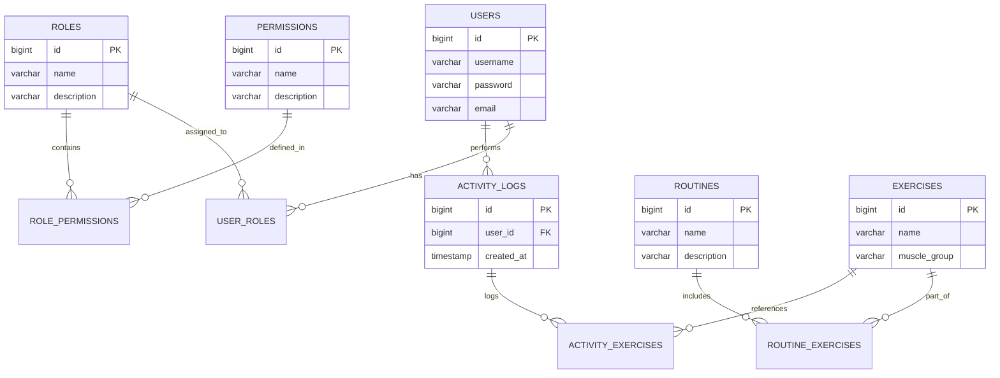

# Arquitectura y Diseño del Sistema

Documento canónico que define la estructura de capas, componentes y el modelo relacional del proyecto.

## Estructura de Capas de la Aplicación

## Convención de Paquetes

- `com.example.teacher.config`: Configuraciones globales de Spring Security, beans de seguridad y CORS.
- `com.example.teacher.controller.mvc`: Controladores que renderizan vistas Thymeleaf (`UserMVCController`, `AuthMVCController`, etc.).
- `com.example.teacher.controller.rest`: Controladores REST con `@RestController` que entregan respuestas JSON y códigos de estado semánticos (`AuthRestController`, `UserController`, etc.).
- `com.example.teacher.dto`: Objetos de transferencia de datos clasificados en requests y responses.
- `com.example.teacher.exception` y `RestExceptionHandler`: Manejo centralizado de errores vía `@RestControllerAdvice`.
- `com.example.teacher.mapper`: Interfaces de mapeo MapStruct entre Entidades JPA y DTOs.
- `com.example.teacher.model`: Entidades JPA anotadas con Jakarta Persistence (`@Entity`, `@Table`).
- `com.example.teacher.repository`: Interfaces que extienden `JpaRepository` o `CrudRepository`.
- `com.example.teacher.service`: Lógica de negocio transaccional (`@Service`).

## Modelo de Dominio y Entidades

## Reglas Arquitectónicas Obligatorias
1. Los controladores no deben acceder directamente a la capa de persistencia (Repositories); toda invocación debe canalizarse a través de la capa de Servicios (`@Service`).
2. Las entidades JPA nunca deben exponerse directamente en endpoints REST ni recibirse como payload crudo; deben mapearse obligatoriamente con DTOs y MapStruct.
3. El manejo de transacciones de escritura debe declararse a nivel de servicio con `@Transactional`.
4. Los endpoints REST deben respetar el context-path global configurado (`/compunet2-2026`).
