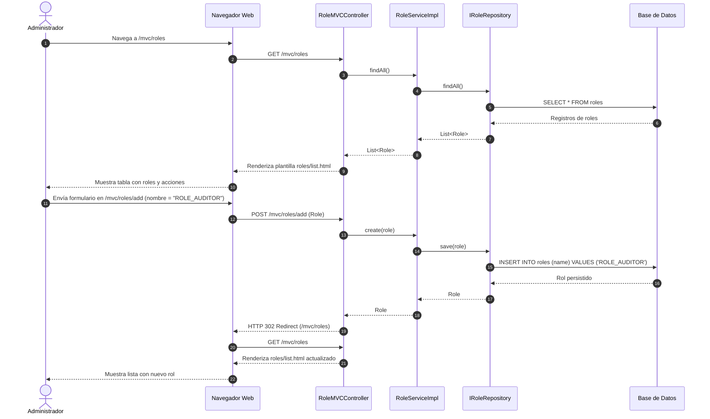

# [PLAN-001] Implementación de RoleMVCController y Vistas MVC de Roles

## Metadatos
- ID: PLAN-001
- Spec Asociada: [SPEC-001](../specs/roles-mvc-spec.md)
- Fecha: 2026-10-24
- Estado: COMPLETED

## Resumen de la Solución Técnica
Implementación del controlador MVC `RoleMVCController` bajo la ruta base `/mvc/roles` para la administración de roles, junto con las vistas Thymeleaf (`list.html`, `add.html`, `edit.html`) y sus estilos CSS asociados. Se reutilizará la lógica existente en `IRoleService` y `RoleServiceImpl`, y se integrará la navegación con el componente reusable `sidebar.html`.

## Impacto en Capas y Componentes

### 1. Base de Datos y Persistencia
- **Entidades JPA (`com.example.teacher.model`)**:
  - `Role`: Ya existe con campos `id` (Integer), `name` (String), relación `@OneToMany` con `User` y `RolePermission`. No requiere alteraciones en BD.
- **Repositorio (`com.example.teacher.repository`)**:
  - `IRoleRepository`: Ya provee las operaciones CRUD extendiendo `JpaRepository<Role, Integer>`.

### 2. Capa de Servicios
- **Interface e Implementación (`com.example.teacher.service`)**:
  - `IRoleService`: Ya expone los métodos necesarios:
    - `List<Role> findAll()`
    - `Optional<Role> findById(Integer id)`
    - `Role create(Role role)`
    - `Role update(Integer id, Role role)`
    - `void deleteById(Integer id)`
  - `RoleServiceImpl`: Implementa las operaciones sobre `IRoleRepository`. Se reutiliza sin modificar lógica de persistencia.

### 3. Capa de Controladores y Vistas MVC
- **Controlador MVC (`com.example.teacher.controller.mvc`)**:
  - Clase: `RoleMVCController`
  - Anotaciones: `@Controller`, `@RequestMapping("/mvc/roles")`, `@RequiredArgsConstructor`, `@Slf4j`
  - Inyección de dependencias: `IRoleService roleService`
  - Endpoints expuestos:
    1. `GET /mvc/roles`: Lista todos los roles y los agrega al modelo (`roles`). Retorna `roles/list`.
    2. `GET /mvc/roles/add`: Prepara un objeto `Role` vacío en el modelo (`role`). Retorna `roles/add`.
    3. `POST /mvc/roles/add`: Recibe `@ModelAttribute Role role`, invoca `roleService.create(role)` y retorna redirección `redirect:/mvc/roles`.
    4. `GET /mvc/roles/edit/{id}`: Busca el rol por id vía `roleService.findById(id)`, lo agrega al modelo (`actualRole`). Retorna `roles/edit`.
    5. `PostMapping` o `PutMapping("/edit/{id}")`: Recibe `@PathVariable Integer id`, `@ModelAttribute Role role`, actualiza vía `roleService.update(id, role)` y redirige a `redirect:/mvc/roles`.
    6. `GetMapping` o `DeleteMapping("/delete/{id}")`: Recibe `@PathVariable Integer id`, invoca `roleService.deleteById(id)` y redirige a `redirect:/mvc/roles`.
- **Plantillas Thymeleaf (`src/main/resources/templates/roles/`)**:
  - `roles/list.html`: Tabla con columnas ID, Nombre y Acciones (Editar, Eliminar) e inclusión del fragmento `components/sidebar :: sidebar`.
  - `roles/add.html`: Formulario para registrar nombre del rol con acción a `/mvc/roles/add`.
  - `roles/edit.html`: Formulario para editar rol existente cargando `actualRole.name`.
- **Estilos CSS (`src/main/resources/static/css/roles/`)**:
  - `css/roles/list.css` y `css/roles/add.css`: Estilos visuales consistentes con la sección de usuarios.

### 4. Seguridad y Autorización
- `WebSecurityConfig`:
  - `mvcSecurityFilterChain` ya cubre `/mvc/**`, `/css/**`, `/js/**`. Los accesos a `/mvc/roles/**` quedan protegidos por el filtro de sesión autenticada existente.
  - El componente `sidebar.html` ya contiene el enlace `<li><a th:href="@{/mvc/roles}">Roles</a></li>`.

## Diagrama de Secuencia

## Consideraciones de Seguridad y Manejo de Errores
- Comportamiento ante rol no encontrado en `edit/{id}`: Redirección limpia o mensaje de advertencia.
- Manejo de restricciones de integridad referencial: Si un rol tiene usuarios asignados, la eliminación a nivel de BD puede fallar por clave foránea; se debe contemplar la captura de la excepción en capa web o servicio.