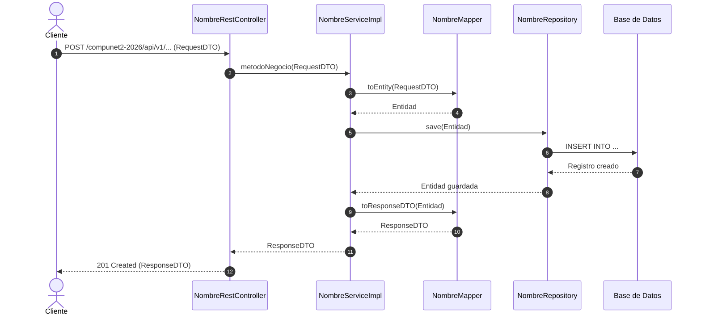

# [PLAN-XXX] Plan Técnico de Implementación

## Metadatos
- ID: PLAN-XXX
- Spec Asociada: [SPEC-XXX](../specs/SPEC-XXX.md)
- Fecha: YYYY-MM-DD
- Estado: [DRAFT | READY_FOR_TASKS | IN_PROGRESS | COMPLETED]

## Resumen de la Solución Técnica
Breve descripción técnica de cómo se resolverá la especificación a nivel de arquitectura, librerías y componentes, sin escribir código de producción aquí.

## Impacto en Capas y Componentes

### 1. Base de Datos y Persistencia
- Tablas nuevas o modificadas:
  - `nombre_tabla` (columnas, tipos, restricciones, claves foráneas).
- Scripts DDL / DML:
  - Cambios en `src/main/resources/data.sql` o migraciones correspondientes.
- Entidades JPA (`com.example.teacher.model`):
  - `@Entity NombreEntidad` (anotaciones clave: `@Table`, `@Id`, `@GeneratedValue`, `@ManyToOne`, etc.).
- Repositorios (`com.example.teacher.repository`):
  - `NombreRepository extends JpaRepository<NombreEntidad, Long>` (declaración de métodos derivados o `@Query`).

### 2. DTOs y Mappings
- Objetos de Transferencia (`com.example.teacher.dto`):
  - `NombreRequestDTO` (anotaciones de validación Jakarta: `@NotBlank`, `@NotNull`, etc.).
  - `NombreResponseDTO`.
- Mappers (`com.example.teacher.mapper`):
  - `NombreMapper` con anotación `@Mapper(componentModel = "spring")`.

### 3. Capa de Servicios
- Interface e Implementación (`com.example.teacher.service`):
  - `NombreService` y `NombreServiceImpl` con anotación `@Service`.
  - Definición de métodos transaccionales con `@Transactional`.
  - Lógica de validaciones de negocio y manejo de excepciones de dominio.

### 4. Capa de Controladores y Seguridad
- Controlador (`com.example.teacher.controller.rest` o `controller.mvc`):
  - `NombreRestController` anotado con `@RestController` y `@RequestMapping("/api/v1/...")`.
  - Reglas de autorización en `WebSecurityConfig` o `@PreAuthorize("hasRole('...')")`.

## Diagrama de Secuencia

## Consideraciones de Seguridad y Manejo de Errores
- Excepciones personalizadas que deben ser capturadas en `RestExceptionHandler`.
- Restricciones de acceso y validación de tokens JWT.
